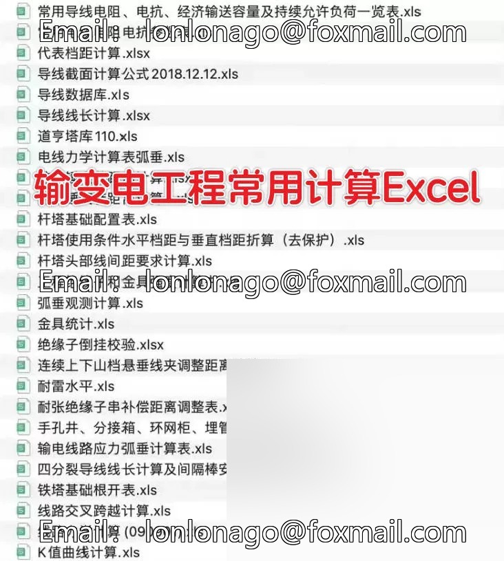
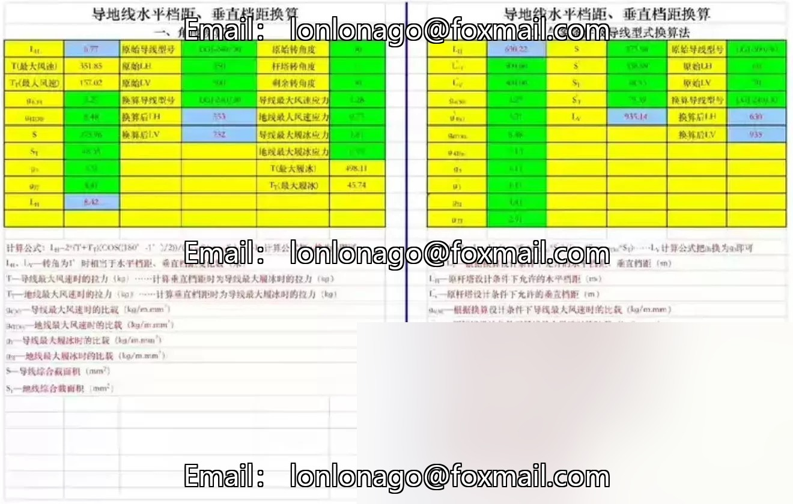
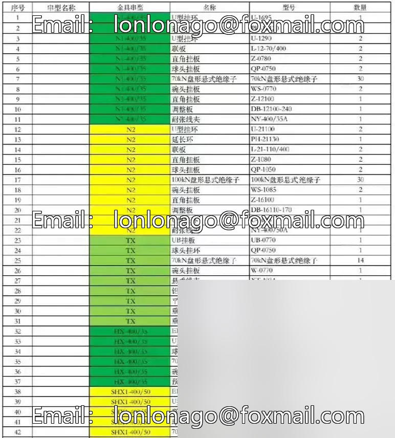

# Power transmission and transformation engineering common calculation Excel

## Body

Transmission and transformation engineering commonly used Excel
A total of 27 tables packaged

The following are:
Content as follows:
Common wire resistance, reactance, economic transmission capacity, and continuous allowable load overview table.xls
Common cable resistance and reactance parameter table.xls
Representative spacing calculation.xlsx
Wire cross-section formula 2018.12.12.xls
Wire database.xls
Wire length calculation.xlsx
Daoheng tower database.xls
Rigging foundation configuration table.xls
Rigging use conditions horizontal spacing and vertical spacing conversion (without protection).xls
Rigging head line spacing requirement calculation.xls
Engineering insulators and clamps strength calculation report.xls
Wire mechanics calculation table arc length.xls
Shake damping hammer installation distance calculation.xlsx
Arc length observation calculation.xls
Clamp statistics.xls

Iron tower foundation root setup table.xls
Line crossing calculation.xls
Insulator hanging check.xlsx
Continuous vertical and horizontal adjustment distance calculation.xlsx
Radiation resistance level.xls
Reinforcing insulator string compensation distance adjustment table.xls
Manhole well, spliters box, ring network cabinet, buried pipe (for reference).xls
Transmission line stress arc and sag calculation table.xls
Four-stranded wire length calculation and clearance bar installation distance table-W line.xlsx
Line mechanical calculation (090901).xls
K-value curve calculation.xls

web-based shipment, can be directly photographed and shipped.

This collection contains common calculation Excel files for the power transmission and distribution engineering, packaged in 27 tables covering various wires, towers, insulators and related calculations.

<!-- AI_ENRICHED -->

## Images

## Payment

Here is a pay link on Stripe ( https://buy.stripe.com/3cs8yP7sY87d0vu9AB ). Please contact me lonlonago@foxmail.com after funding $89, and I will send you a complete data files , thank you!

